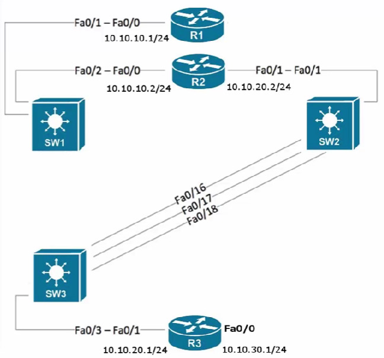

# Basic Connectivity Troubleshooting (Ping, Traceroute, and Telnet)

## Overview

A reported DNS or website failure can involve routing, name resolution, or a blocked service port. This lab uses `ping`, `traceroute`, and a TCP-port test with `telnet` to investigate those dependencies separately.

## Key Concepts

### Verification vs. Report Trust
Reproduce the reported symptom before choosing a cause. A browser error, for example, does not establish whether the fault is in DNS or routing.

### Isolating Protocol Dependencies
When diagnosing high-level application services like DNS, testing via hostname binds the result to the functionality of name resolution. Troubleshooting by raw IP address removes the Application Layer dependency, letting you check basic Layer 3 connectivity in isolation.

### Traceroute Time-to-Live (TTL) Operation
Traceroute uses the IP header's **TTL (Time to Live)** field to identify responding hops along a path. TTL also limits how long a looping packet can circulate.
- The source sends packets starting with a **TTL of 1**.
- The first router decrements the TTL to 0, drops the packet, and returns an **ICMP Time Exceeded** message.
- The source increments the TTL sequentially (**TTL=2, TTL=3, etc.**) to map every successive router along the path until a drop or failure occurs.

## How It Works

### Troubleshooting a Remote Subnet Break Scenario



```text
  [ R1 (Client Router) ] ------------ (10.10.10.0/24) ------------> [ R2 (Transit Router) ] --x (10.10.20.0/24) --x> [ R3 (DNS Server) ]
     IP: 10.10.10.1                                                    IP: 10.10.10.2                                   Target IP: 10.10.30.1
           |                                                                  |                                                |
           |---- 1. ping 10.10.30.1 (Fails) --------------------------------->|                                                |
           |                                                                  |                                                |
           |---- 2. traceroute 10.10.30.1 ----------------------------------->|                                                |
           |        - Packet 1 (TTL=1) -> Arrives at R2 (TTL=0)               |                                                |
           |<------- R2 responds with ICMP Time Exceeded (10.10.10.2) --------|                                                |
           |        - Packet 2 (TTL=2) -> Sent to R2                          |-- 3. R2 evaluates Routing Table                |
           |<------- R2 drops packet & stops path (No Route Found) -----------|      Result: Missing route to 10.10.30.0/24   |
           |                                                                                                                   |
     [ Conclusion: Path breaks *at* R2. Admin logs onto R2 to apply the missing static route fix. ]                            |
           |                                                                                                                   |
           |---- 4. Fix Applied on R2: 'ip route 10.10.30.0 255.255.255.0 10.10.20.1' ----------------------------------------->|
           |                                                                                                                   |
           |==== 5. Verification: telnet 10.10.30.1 53 (Verifies Port 53 Open / DNS Active) =================================>|
```

## Components / Structure

### Troubleshooting Tools by Layer Focus

| Tool | Primary OSI Layer | Protocol Used | Troubleshooting Function |
| --- | --- | --- | --- |
| **`ping`** | Layer 3 (Network) | ICMP (Echo Request/Reply) | Verifies end-to-end, two-way basic IP reachability. |
| **`traceroute`** | Layer 3 (Network) | ICMP / UDP (with variable TTL) | Discovers the hop-by-hop path and localizes the exact dropping node. |
| **`telnet`** | Layer 4 (Transport) | TCP | Probes a destination IP on a specific port to check if an application daemon is listening. |

## Comparison

### Core Command Utility Signatures

| Metric | Ping | Traceroute | Telnet (Targeted) |
| --- | --- | --- | --- |
| **Verification Scope** | Bidirectional confirmation. | Sequential path discovery. | Transport layer port check. |
| **Action on Failure** | Indicates absolute failure or timeout somewhere on the path. | Isolates the last successful interface before the failure. | Distinguishes between an inactive service and a total system outage. |
| **Common Use Case** | Initial sanity check for host connectivity. | Pinpointing routing breaks or loops across networks. | Confirming if firewalls or ACLs are blocking specific application ports. |

## Commands (If Applicable)

### Windows

```bash
# Test basic IP layer connectivity
ping 10.10.30.1

# Trace network paths hop-by-hop (Windows uses ICMP Echo Requests)
tracert 10.10.30.1

# Verify if a specific application port is accepting connections (e.g., DNS over TCP)
telnet 10.10.30.1 53

```

### Linux

```bash
# Test connectivity (runs continuously until stopped via Ctrl+C)
ping 10.10.30.1

# Trace path (Linux default implementation utilizes UDP probing packets)
traceroute 10.10.30.1

# Probe service port status
telnet 10.10.30.1 53
```

### Cisco IOS

```text
! Checking basic Layer 3 connectivity
Router-R1# ping 10.10.30.1

! Tracking the hop-by-hop path to an endpoint
Router-R1# traceroute 10.10.30.1

! Reviewing the local routing configuration layout
Router-R2# show ip route

! Injecting a corrective static next-hop route entry
Router-R2# configure terminal
Router-R2(config)# ip route 10.10.30.0 255.255.255.0 10.10.20.1
Router-R2(config)# end

! Verifying if a remote application socket is actively listening
Router-R1# telnet 10.10.30.1 53
```

## Example

### Troubleshooting Lab Incident Report: Missing Intermediate Static Route

* **Symptom:** R1 CLI reports `Unrecognized host or address` when running `ping R3` (hostname resolution failure).
* **Isolation Step 1:** Run `ping 10.10.30.1` (by IP) from R1. Failure shows that this ICMP exchange did not complete; it removes DNS name resolution from this test but does not prove a Layer 3 root cause or exclude filtering and return-path problems.
* **Isolation Step 2:** Run `traceroute 10.10.30.1` from R1. The first hop (`10.10.10.2` / R2) responds, while later probes time out. Investigate R2, its next hop, and the return path; the trace alone does not establish R2 as the failing node.
* **Root Cause Analysis:** Inspecting R2 with `show ip route` reveals that R2 has no route entry matching the destination `10.10.30.0/24` network.
* **Resolution Implementation:** Add the static route on R2 pointing to R3's connecting boundary interface (`10.10.20.1`).
* **Final Validation:** Testing with `telnet 10.10.30.1 53` returns an open response, confirming the application socket is responsive. Running `ping R3` by hostname now succeeds.

## Important Notes

* **Verify First:** Always test user complaints using objective diagnostic tools before altering configurations. Typographical mistakes or local host problems frequently masquerade as major infrastructure outages.
* **The Return Path Factor:** Pings test *two-way* traffic loops. A failing ping does not inherently mean the packet never reached the target; it can mean the target host lacks a return route back to your subnet.
* **Telnet Service Audits:** Beyond establishing remote CLI terminal connections (Port 23), appending an explicit port suffix onto the `telnet` utility allows you to map firewall rule exceptions or confirm active server application processes.

## My Takeaways

* Troubleshooting should systematically isolate dependencies, such as testing by raw IP address to decouple routing problems from name resolution (DNS) failures.
* Traceroute relies on the incremental manipulation of the IP header's TTL field to force intermediate routers to reveal their identities via ICMP timeout messages.
* When a traceroute halts at a specific router, the next downstream hop or link is typically where the routing misconfiguration or physical line failure resides.
* A router cannot pass traffic toward a destination network if it lacks a matching entry in its internal routing table, resulting in an immediate packet drop.
* A targeted `telnet` command tests connectivity to a TCP port when ICMP ping results are insufficient.
